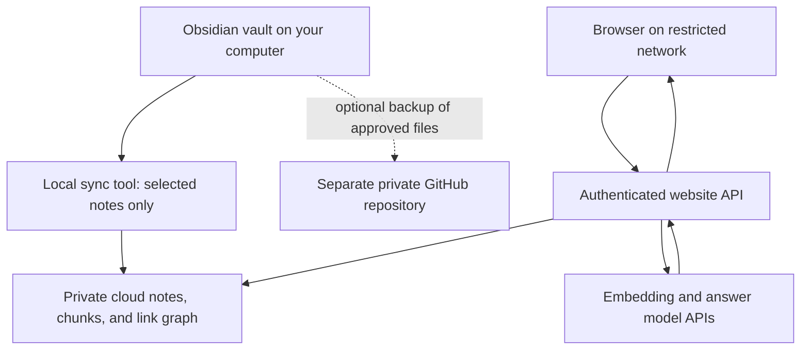

# Aria setup and next steps

Prepared 31 October 2026. This is the implementation plan; cloud services and AI calls have not been configured. The local starter vault and audit tool are implemented.

## Latest user preference — no paid API budget

Support both Gemini and DeepSeek. Start with Gemini's API free tier only after verifying the account tier; leave DeepSeek and all paid calls disabled. The current generation budget is PHP 0, superseding the illustrative PHP 300 allowance below. Stop on free-quota exhaustion instead of falling back to a paid service. Start with non-sensitive sample notes; private content is not approved for the free AI tier. These are implementation requirements, not currently enforced runtime controls.

The user's Gemini subscription does not establish API entitlement: Google distinguishes AI Studio subscription benefits from direct API usage. Create/check a Free-tier project in AI Studio without enabling billing. Keep API keys in server secrets, never chat or notes. Sources: [Google AI plans](https://ai.google.dev/gemini-api/docs/google-ai-plans), [API billing](https://ai.google.dev/gemini-api/docs/billing).

## Decision

Use Obsidian as the source of truth. Start with a small local vault. For the cloud prototype, prefer **Supabase Free** for PostgreSQL full-text search, vector search, note relationships, and authentication. Keep **private GitHub** optional for versioned backup. Do not change the existing Firebase project.

This recommendation is about fitting the required retrieval methods into one service, not a promise that Supabase is always cheaper. Reconsider after measuring the first real index. Supabase documents a 500 MB free database and pauses free projects after a week of inactivity; Pro starts at $25/month, which would dominate a small AI budget. Stay within the free plan during the experiment. [Supabase pricing](https://supabase.com/pricing)

| Choice | Role and tradeoff | Decision |
| --- | --- | --- |
| Supabase Free | Keyword search, vector search, and relational links in one database; constrained capacity and free-project availability | Preferred prototype |
| Existing Firebase | Can remain in use for other apps; reuse would require checking edition, billing, auth, and isolation | Leave untouched; viable alternative |
| Separate Firebase project | Useful if Firebase integration matters more; validate the required search features and their edition-specific costs | Fallback after comparison |
| Private GitHub repository | Markdown storage and history; does not itself provide the proposed semantic retrieval service | Optional backup |
| Local-only search | No hosted database cost; unavailable to the website while the computer is off unless a separate searchable copy is hosted | Development and evaluation |

Supabase documents combining PostgreSQL full-text and vector results. Firebase now also documents native text search under Firestore Enterprise; the older blanket statement that Firestore has no full-text search is not a sound basis for choosing a platform. Do not apply Standard-edition free-quota assumptions to Enterprise features. [Supabase hybrid search](https://supabase.com/docs/guides/ai/hybrid-search), [Firestore text search](https://firebase.google.com/docs/firestore/enterprise/text-search)

GitHub Free supports private repositories. A private repository is access-controlled cloud storage, not end-to-end encryption. Keep the future vault backup separate from the app repository; do not publish the vault with GitHub Pages. [GitHub plans](https://docs.github.com/en/get-started/learning-about-github/githubs-plans)

## 1. Open and use the vault now

The folder is `C:\Users\Ataraxia\Desktop\Aria\vault\Aria Knowledge`.

1. Open Obsidian, choose **Open folder as vault**, and select that folder. Obsidian will create its own local settings.
2. Open `Start Here.md`.
3. In Settings, enable the core Templates plugin and set its folder to `80 Templates`.
4. Under Files and links, set new notes to `00 Inbox`, attachments to `90 Attachments`, and enable automatic updates to internal links.
5. Add 20–50 representative notes. Start with material you actually want to ask about; preserve original sources and dates.
6. Write ten real questions in `40 Questions/Questions to Test.md`. Include questions whose answers require several notes and questions the vault cannot answer.

You do not need plugins, a paid Obsidian subscription, or a cloud database to begin using this local vault. Folder structure is deliberately shallow; meaning should come from clear titles, headings, aliases, and links. [Opening a vault](https://help.obsidian.md/manage-vaults), [Templates](https://help.obsidian.md/plugins/templates)

| Folder | Put here |
| --- | --- |
| 00 Inbox | Unprocessed notes, imports, rough captures |
| 10 Sources | Original excerpts, source details, and your summaries |
| 20 Topics | One concept/entity per note, with aliases and useful links |
| 30 Synthesis | Comparisons, arguments, theories, and conclusions across sources |
| 40 Questions | Questions, expected evidence, unresolved issues |
| 50 Maps | Topic indexes and navigation pages |
| 80 Templates | Reusable note structures |
| 90 Attachments | Images and PDFs; text extraction is a later feature |
| 98 Private | Local-only notes, excluded from the proposed sync and backup |
| 99 Archive | Material you no longer want retrieved by default |

Templates default `ai_enabled: false`. Later cloud sync must require explicit `ai_enabled: true` in a permitted folder. The flag alone does not send anything anywhere. The local audit only measures selected folders; it does not interpret this flag or upload anything.

## 2. Intended architecture

The browser uses the website's origin for questions and source previews. Its server talks to the database and AI providers. Use a server-managed authentication flow so direct browser calls to Supabase are not required for normal use. Test the actual login path, scripts, and network rules before deployment. If the server cannot reach providers either, use an approved internal deployment instead.

Your computer only needs to be online to sync edits. The cloud copy serves the last completed sync while it is off. Show the sync timestamp in the website. Citation clicks should show a protected web excerpt with a heading and line range; an optional Obsidian link can open the original on your own computer. Obsidian-only links will not help a work computer without the vault.

## 3. Cloud account setup, when the prototype is ready

1. Create one separate Supabase Free project in a suitable region. Record its database region and project URL. Do not enable paid upgrades as part of this experiment.
2. Enable `pgvector`. Implement the schema below with row-level security enabled before uploading notes. Start with exact vector scans on the small evaluation corpus; add an approximate index only after measuring retrieval quality and size.
3. Configure one owner account and disable open registration. Use authenticated owner-scoped access for reads; restrict ingestion to a separate server-side credential. Privileged keys must never appear in browser code.
4. Configure server secrets for the database and chosen model provider through the deployment secret manager. Do not paste secrets into notes, GitHub, or chat.
5. Deploy a private-access Next.js website/API, provisionally on Vercel subject to its current plan limits. Keep frontend and API on one origin. Check hosting terms, function limits, and connectivity at deployment time.
6. Run a tiny test with non-sensitive sample notes, then check login, citations, deletion, usage accounting, and network access.
7. Enable upload of approved real notes only after those checks pass.

These are staged implementation steps, not commands that have already run. No provider keys or cloud account are required for today's vault setup.

## 4. Data model and synchronization contract

| Table | Required data |
| --- | --- |
| vaults | id, owner id, name, active index generation, last successful sync |
| notes | stable id, vault id, relative path, title, aliases, tags, source metadata, approved Markdown, content hash |
| chunks | id, note id, generation, heading path, source line range, text, text-search vector, embedding, embedding model/version/dimensions |
| links | source note id, raw target, resolved target id, heading/block target, ambiguity status |
| sync_runs | manifest hash, pending/complete/failed status, counts, error summaries, timestamps |
| usage | owner id, idempotency key, provider, model, mode, token usage, price version, reserved and settled cost, status |

Every read, retrieval query, graph expansion, and source-preview endpoint must enforce ownership. RLS protects user-scoped access; privileged ingestion still requires explicit ownership validation. No raw note content in application logs.

The local sync tool should:

1. Read only explicit folder allowlists; exclude hidden folders, templates, inbox, archive, attachments, and `98 Private` by default. Exclude evaluation answer keys, including `40 Questions/Questions to Test.md`, even if they are accidentally marked for AI. Skip symlinks and junctions.
2. Parse YAML with a real parser and require boolean `ai_enabled: true`. Malformed or absent permission means skip. Folder exclusions take precedence over note metadata.
3. Preserve headings, aliases, tags, wiki/Markdown links, block ids, source lines, and original paths. Resolve relative links and duplicate filenames explicitly; ambiguous links remain unresolved.
4. Split primarily at headings/paragraphs, initially targeting about 500–900 tokens, with limited overlap where needed. Keep tables and code blocks intact where practical and enforce a hard embedding-model input limit.
5. Hash source content and reuse unchanged embeddings. A move must update paths and links without creating permanent duplicates; stable note ids can live in a local manifest without rewriting source notes.
6. Stage updates under a new generation and activate them only after success. A complete scan detects deleted notes; an interrupted scan must never be interpreted as mass deletion.
7. If permission is withdrawn or a note becomes private, revoke cloud access and invalidate cached results immediately on the next successful sync. Retire old generations and associated embeddings. Provider retention and any separate Git history require separate handling.
8. Record last successful sync and recover idempotently after interruption. Begin with a manual sync command; add scheduling after it is reliable.

The app code repository ignores the whole local vault. For optional private GitHub backup, initialize a separate repository inside the vault only when ready. Its provided `.gitignore` excludes the private folder, workspace settings, and likely secret files. Review the actual staged filenames before the first push. Git ignore rules do not remove already committed history. Local-only notes still need a separate private backup strategy.

## 5. Retrieval and answer behavior

Normal mode: retrieve about 20 keyword and 20 semantic candidates, merge rankings, expand up to one hop of explicit links, deduplicate, and select evidence from several notes under an 8,000-token total input budget. This includes question, instructions, chat history, metadata, and excerpts. Begin with deterministic ranking; add a learned reranker only if evaluation shows a benefit. Preserve the unexpanded query to avoid losing exact names.

For indirect evidence, keep a small, separately labeled set of potentially relevant passages. A link or similarity score is a lead, not proof of a causal relationship. The final answer must distinguish supported claims, plausible interpretation, contradictions, and missing evidence. Each citation must refer to an actual retrieved chunk and its original source range.

Research mode: allow at most one planning call, a bounded set of follow-up searches, and one synthesis call; reserve a third call only for a defined repair. Cap total tokens and calls across the whole request. Stop on sufficient evidence or exhausted budget, and describe unresolved gaps. Never scan or summarize the whole vault by default.

Treat note text as evidence rather than executable instructions. Do not execute commands, follow external URLs, or change permissions because retrieved content asks for it. Do not let generated model text invent source ids; validate citations against the supplied evidence set. Test both citation existence and whether cited text supports the claim.

**Embedding constraint:** local note embeddings still require compatible embeddings for online questions. A hosted website cannot rely on the home computer being awake. Choose either an API embedding model for both sides, or a local document embedder with that exact model hosted server-side for queries. Do not combine unrelated models because their vector dimensions happen to match. Keep model choice open until language and hosting requirements are known.

## 6. Model selection and costs

Do not declare a universal winner from the pasted conversation. Start by comparing **Gemini 3.8 Flash** (quality candidate) with **DeepSeek Flash** (budget candidate). Use GPT-6 Luna as an optional third cost baseline. Model access, quotas, and real performance need an account-level check and a vault-specific evaluation.

Verified published rates below are USD per million tokens on 31 October 2026. Calculations assume 1,500 questions per 30-day month, 8,000 uncached input tokens and 1,000 total billable output tokens per question, one call, and no extra tool charges.

| Candidate | Input / output rates | Example generation total |
| --- | --- | --- |
| Gemini 3.8 Flash free | Free within account quota; content-use terms apply | $0 only within quota |
| Gemini 3.8 Flash paid Standard | $0.75 / $3.75 through 31 Dec 2026 | $14.625/month |
| DeepSeek `deepseek-flash` | $0.15 / $0.60 off-peak; $0.30 / $1.20 peak | $2.70–$5.40/month |
| GPT-6 Luna Standard short context | $0.10 / $0.50 | $1.95/month |

Gemini's listed Standard prices rise to $1.50/$7.50 on 1 January 2027; the same example becomes $29.25. Its free tier permits content use to improve products; its standard paid tier lists otherwise. Keep private content off the free tier by default. Free quota exhaustion must never trigger an automatic paid fallback. [Gemini pricing and data-use distinctions](https://ai.google.dev/gemini-api/docs/pricing)

DeepSeek's documented API id is `deepseek-flash`, currently serving V4.1 Flash. Use peak prices when reserving a request budget, then reconcile against actual usage and the applicable tariff. [DeepSeek pricing](https://api-docs.deepseek.com/quick_start/pricing/)

OpenAI's Standard short-context rates support the Luna estimate; this does not establish its retrieval/synthesis quality for your notes. [OpenAI pricing](https://developers.openai.com/api/docs/pricing?tab=suite)

Convert with your actual payment rate: **monthly PHP = monthly USD × PHP per USD**, plus tax/bank fees. For illustration only, at PHP 60/USD these generation estimates are about PHP 878 for paid Gemini, PHP 162–324 for DeepSeek, or PHP 117 for Luna. PHP 60 is a round planning assumption, not a live exchange-rate claim. Embedding, reasoning, retries, research calls, hosting, storage and backups are extra.

A proposed PHP 300 monthly generation allowance is a starting preference, not an implemented or guaranteed bank-charge cap. The future backend must atomically reserve worst-case cost before each request, count all concurrent requests and retries, reconcile actual usage, and stop when the budget is insufficient. Ambiguous timeouts retain reservations until reconciled. Include billed thinking tokens. Fail closed if pricing or exchange-rate configuration is missing or expired. Database/hosting bills and use outside this app need separate controls.

## 7. Ordered build milestones

| Order | Deliverable | Completion check |
| --- | --- | --- |
| 0 — ready now | Starter vault, templates, setup plan, local audit | Vault opens; local audit runs without uploading content |
| 1 — next | 20–50 representative notes and 10 real questions | Sources, language mix, privacy choices, and expected answers recorded |
| 2 | Local Markdown importer and keyword retrieval | Correct aliases, headings, link targets and source spans; excluded notes never appear |
| 3 | Private cloud schema and incremental sync | Owner isolation, delete/rename/permission withdrawal, interrupted-sync recovery tested |
| 4 | Semantic + keyword + graph retrieval | Finds expected sources on exact, paraphrased and indirect questions |
| 5 | Cited answers and model comparison | Same frozen evidence used to compare models; usage and unsupported claims recorded |
| 6 | Website with login, source viewer and spending controls | Actual restricted-network login and querying work; unknown users denied |
| 7 | Full import and scheduled sync | Measured storage fits chosen plan; cached answers invalidate on edits; last-sync status visible |

Before full import, measure text, embeddings, indexes, and database overhead from the sample. Three million English words might yield several thousand chunks, but attachments, many short notes, languages, overlaps and dimensions change this substantially. The audit's raw-vector estimate is not total database storage.

## 8. Evaluation worksheet

Use `eval/questions.example.json` and the vault's Questions to Test page. Begin with ten questions; expand to thirty before selecting a production model: six exact lookups, six paraphrases/aliases, six multi-note connections, four contradictions, four unanswerable questions, and four stale/deleted/adversarial-content cases.

Evaluate retrieval independently from generation. First check whether the expected source passages were retrieved. Then give identical evidence to each model and score factual support, citation support, missing relevant evidence, distinction between fact and inference, latency, and billed cost. Finally compare the entire pipeline, including query expansion and multiple calls.

Proposed release gates: all isolation/deletion tests pass; all no-evidence cases acknowledge missing evidence; zero fabricated source ids; at least 90% of known required sources retrieved within the evidence budget on the annotated small test set; manually review every factual claim in the pilot answers. These are development targets, not statistical guarantees from a small sample.

## What remains to decide

- Subject areas and languages in the first notes, and whether scanned PDFs/images need extraction.
- Exact network restrictions, especially login and backend egress.
- Whether any selected note may go to a hosted/free AI service.
- Confirmed monthly spending preference and chosen provider after evaluation.

None of these prevents starting the local vault today.
